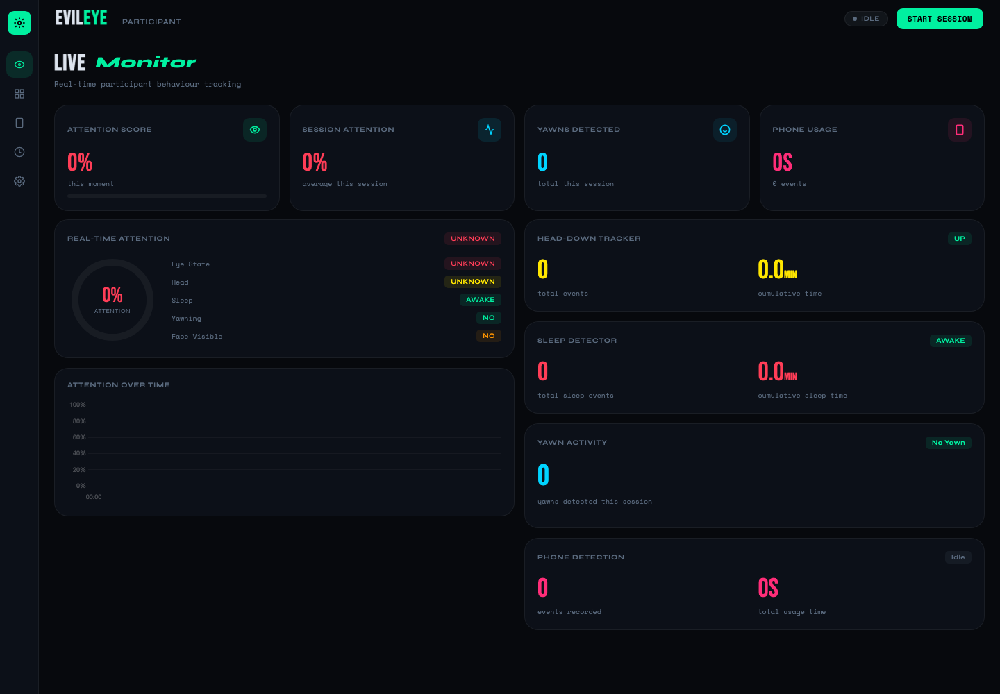

# Evil Eye Ecosystem

Evil Eye is a computer-vision prototype for observing attention-related signals during a session. The dashboard can display attention estimates, yawns, head-down events, sleep-related events and phone-use detections.

## Demo

[Watch the short project video](https://youtube.com/shorts/4h5WTwZ2bsw?si=NBs6G3ahiVE12rb3)

## Project components

- **Live dashboard:** session status, attention indicators, event counters and a session timeline.
- **Behavior analysis:** OpenCV and NumPy based image processing modules.
- **Detection modules:** phone use, head-down posture, yawns and sleep-related signals.
- **Jetson path:** TensorRT and PyCUDA detector integration for compatible NVIDIA Jetson hardware.
- **Local dashboard server:** serves session state to the browser and supports JSON/CSV exports.

## Repository map

- **single_student_main.py** — single-session capture and detection loop.
- **student_tracker.py** — combines behavior signals and session tracking.
- **behavior_analyzer.py**, **phone_detector.py**, **head_down_tracker.py**, **sleep_tracker.py** — detection and event modules.
- **trt_yolo_multi.py** — TensorRT YOLO detector integration.
- **server.py** and **dashboard.html** — local dashboard server and interface.
- **validate_*.py**, **test_*.py** — setup and behavior checks.

## Run the dashboard

The dashboard can be opened on its own to inspect the interface:

~~~sh
python3 -m http.server 8000
~~~

Then open http://localhost:8000/dashboard.html.

The live camera pipeline is hardware-specific. The reference setup expects a compatible Jetson environment, camera access, OpenCV/NumPy, TensorRT, PyCUDA and a locally available model engine. Check the deployment notes and install versions that match your JetPack release before starting the capture loop. The project setup guide describes running **single_student_main.py** and **server.py** in separate terminals.

## Privacy and use

This prototype processes camera imagery and infers behavior signals. Use it only with informed consent and a clear, limited purpose. Do not use its estimates alone to grade, discipline or make consequential decisions about a person. The repository screenshot uses an empty demo session and contains no participant footage.

## Author

Built by [Om Rashiya](https://github.com/rashiyaom).
